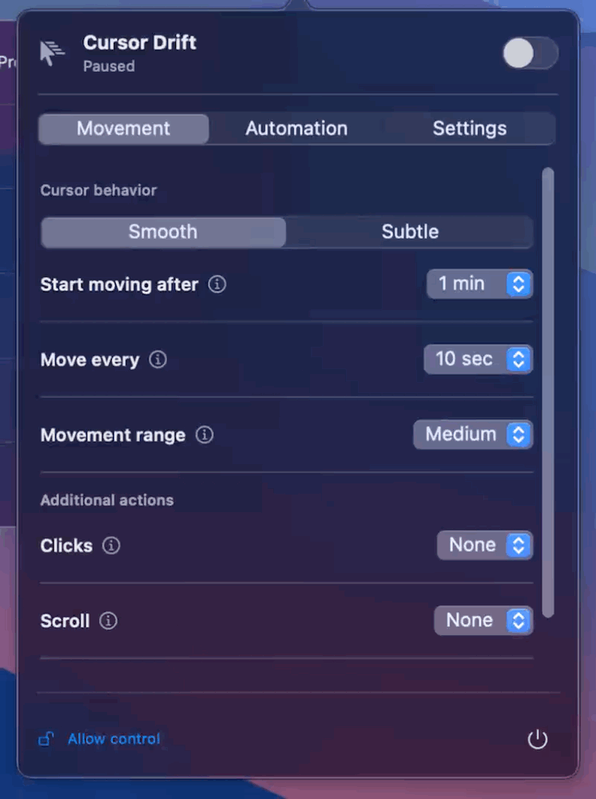

# Cursor Drift



A compact macOS menu bar app that moves your cursor after a period of inactivity.
Built with Swift, SwiftUI, AppKit, and Core Graphics. No third-party dependencies.

[Русский](README.ru.md)

## Features

- A native macOS popover with standard controls and Movement, Automation, and Settings tabs.
- System Liquid Glass on macOS 26+, with a native popover material on earlier versions.
  Appearance follows the system theme.
- English and Russian interfaces, with an in-app language selector.
- Configurable idle delay: 1, 3, 5, 10, or 15 minutes.
- Movement intervals from 2 seconds to 1 minute.
- **Smooth:** a smooth path to a random point.
- **Subtle:** a one-point movement followed by a return to the original position.
- Small, medium, or full-display movement range.
- Weekly schedules, including overnight time windows.
- Automatic deactivation after a selected duration.
- Rules based on whether a selected application is running or in front.
- Optional clicks, one-line scrolling, and Shift key presses, disabled by default.
- Low battery pause with an adjustable 1–100% threshold (default 5%).
- Optional launch at login through macOS Login Items.
- Saved preferences. Movement is paused on every launch.

Physical keyboard and mouse activity cancels the current movement. Movement pauses
when the session becomes inactive or the display sleeps. After wake, the app waits
for the selected idle delay again. There is no separate settings window.

## Install a prebuilt app

Download [Cursor Drift ZIP](Cursor-Drift-macOS-universal.zip), unzip it,
and move **Cursor Drift.app** to **Applications**.
The universal build includes Apple Silicon and Intel code. It requires macOS 13 or later.
**Xcode, Swift, and compilation are not required to use a prebuilt app.**

Open the app and click its cursor icon in the menu bar. Click **Allow control**, then
enable Cursor Drift in **System Settings → Privacy & Security → Accessibility**.
If necessary, add the installed app using the + button and restart it. Select your
language in the **Settings** tab. Enable movement using the top-right switch.

### Signing and Gatekeeper

The default build script uses an **ad hoc signature**. It is not Developer ID signed
or notarized. A downloaded build may be blocked by Gatekeeper; the default ZIP is
therefore a development/test artifact, not a notarized distribution build.

For normal distribution outside the Mac App Store, sign with a Developer ID
Application certificate, submit to Apple's notary service, and staple the ticket
before creating the final ZIP. See
[Apple's distribution guidance](https://developer.apple.com/developer-id/) and
[notarization documentation](https://developer.apple.com/documentation/security/notarizing-macos-software-before-distribution).
Accessibility permission is still required for signed and notarized builds.

## Build from source

Requirements: macOS, Xcode or Command Line Tools with Swift 5.9+ and an accepted
Xcode license. No package downloads are needed.

```sh
# Build for the current Mac.
bash scripts/build.sh

# Build for both Apple Silicon and Intel.
bash scripts/build.sh universal

open "dist/Cursor Drift.app"
```

Outputs are in `dist/`: the app bundle and a ZIP containing it. `native` archives
match the build machine's architecture; use `universal` for both architectures.
The deployment target is macOS 13. Builds on older supported systems and Intel
hardware still need runtime verification.

To sign using an installed certificate:

```sh
SIGN_IDENTITY="Developer ID Application: YOUR NAME (TEAMID)" bash scripts/build.sh universal
```

This enables hardened runtime and timestamped signing. It does **not** submit the
app for notarization. Notarize and staple separately, then recreate the archive.
Never commit certificates, private keys, or Apple credentials.

## Launch at login

Enable **Launch at login** in the popover to start Cursor Drift automatically
when you sign in. It is off until you opt in; movement always starts paused.
Move the app to Applications before enabling this option. If macOS requires
approval, use the displayed link to Login Items in System Settings. The switch
reflects the system registration status; disabling it unregisters the app.

## Battery protection

Enable **Low battery pause** and choose a threshold with the slider. With a 5%
threshold, movement pauses below 5% and resumes at 5% or above if the other
conditions allow it. This pauses automation, not the physical cursor. The battery
is checked every 5 seconds, including while charging. On Macs without an internal
battery, this option has no effect. The toggle and threshold are saved.

## Behavior and limitations

- Schedule times use the Mac's local timezone, with hour precision. Equal start/end
  hours mean the entire selected day. Overnight windows belong to their start day.
- Deactivation uses elapsed wall-clock time from enabling movement or changing the
  deactivation setting, rather than a specific clock time.
- Optional clicks act at the cursor; scrolling and Shift affect the active app.
- No global shortcut or fixed click target yet.
- Remote input and virtual input devices have not been verified.
- The app does not guarantee prevention of sleep/locking or changes to presence
  status in other applications.

## Manual verification

Check permission handling; both languages and saved preferences; opening and
closing the popover; one-minute idle activation; interruption by physical input;
Smooth/Subtle modes; display edges; schedules; app rules; deactivation; sleep and
wake. Test optional clicks/scroll/Shift in a disposable document. Confirm the app
starts paused after relaunch. Verify distribution builds on both architectures
and on a clean Mac after downloading the ZIP.
